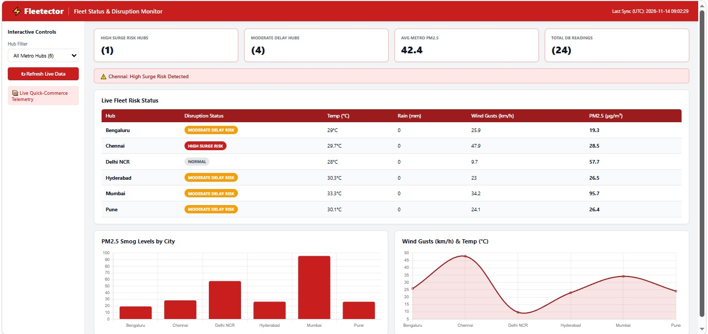
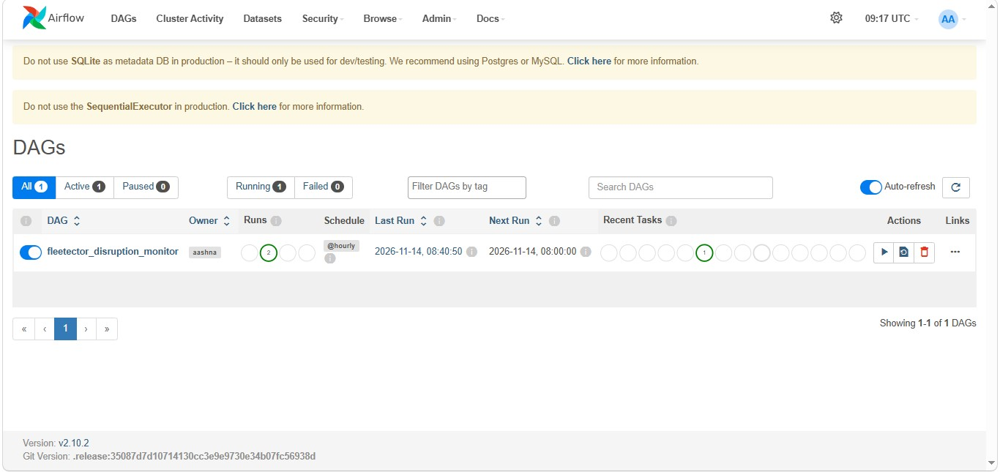
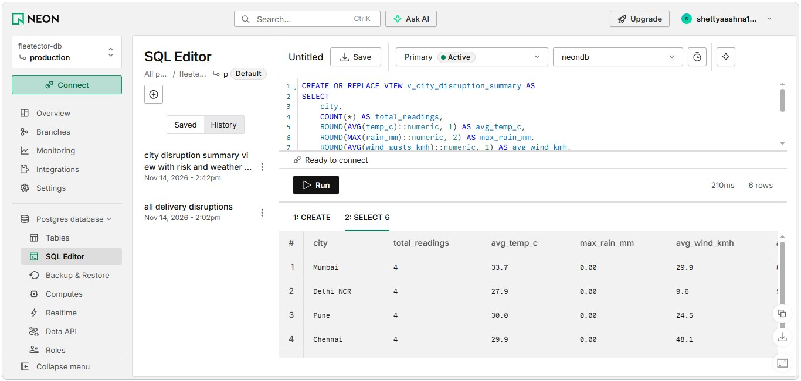

# Fleetector: Real-Time Quick-Commerce Delivery Disruption Monitor


## Description
* Fleetector is an end-to-end data engineering and full-stack telemetry application designed to monitor real-time meteorological and air quality conditions across major Indian quick-commerce delivery hubs.
* It automates hourly data extraction, classifies logistics surge and delay risks, stores historical records in a cloud PostgreSQL database, and visualizes live hub status through a responsive web dashboard.

## Table of Contents
* [1. About the Project](#1-about-the-project)
* [2. Features](#2-features)
* [3. Technologies Used](#3-technologies-used)
* [4. Dashboard & Design Highlights](#4-dashboard--design-highlights)
* [5. App Structure](#5-app-structure)
* [6. Local Setup & Execution](#6-local-setup--execution)
* [7. Screenshots](#7-screenshots)
* [8. Author Notes](#8-author-notes)


## 1. About the Project
Fleetector is an amalgamation of **Fleet** and **Detector**. In rapid-delivery logistics across metropolitan cities, sudden weather shifts—such as heavy rainfall, strong wind gusts, extreme heat, or hazardous PM2.5 smog—directly impact rider safety and delivery SLAs. Fleetector solves this by continuously ingesting live environmental telemetry across six metro hubs (**Mumbai, Delhi NCR, Bengaluru, Hyderabad, Pune, and Chennai**), scoring operational risk automatically, and surfacing real-time alerts for fleet operations teams.


## 2. Features
* **1. Automated Hourly ETL Pipeline:** Extracts live temperature, precipitation, wind gusts, and PM2.5 air quality readings every hour via Python scripts without manual intervention.
* **2. Dynamic Disruption Risk Scoring:** Classifies every hub reading into **High Surge Risk**, **Moderate Delay Risk**, or **Normal** based on real-time wind, rain, temperature, and smog thresholds.
* **3. Workflow Orchestration with Apache Airflow:** Uses a containerized Airflow DAG (`fleetector_disruption_monitor`) with automatic retry fault-tolerance and visual run monitoring.
* **4. Cloud Database & Analytical SQL Views:** Persists structured historical telemetry in serverless Neon PostgreSQL and aggregates city-level metrics through custom SQL views (`v_city_disruption_summary`).
* **5. Interactive Telemetry Dashboard:** Provides live KPI summary cards, dynamic alert banners, a city-by-city hub filter, a real-time risk table, and interactive Chart.js visualizations.


## 3. Technologies Used
* **Frontend:** HTML5, CSS3, Vanilla JavaScript, Chart.js
* **Backend & API:** Python, FastAPI, Uvicorn, SQLAlchemy, Pandas
* **Database:** Neon Serverless PostgreSQL
* **Orchestration & DevOps:** Apache Airflow, Docker Compose, GitHub Codespaces
* **Open-Meteo Weather & Air Quality APIs:** Free, open-source REST APIs used to retrieve real-time meteorological and PM2.5 particulate telemetry across Indian coordinates.


## 4. Dashboard & Design Highlights
* Designed with a clean, high-contrast red-and-white day-mode color palette inspired by modern quick-commerce operations control centers.
* Top-level alert banner dynamically updates whenever any metro hub crosses into **High Surge Risk** or **Moderate Delay Risk**.
* Interactive hub selector filters KPI cards, risk status badges, and charts instantly for either all six metro hubs or an individual city.
* Auto-refresh polling keeps the dashboard synchronized with the latest PostgreSQL database entries.


## 5. App Structure
```
Fleetector/
├── dags/
│   └── fleetector_dag.py              - (Apache Airflow @hourly DAG definition)
├── frontend/
│   ├── index.html                     - (Dashboard layout and KPI containers)
│   ├── style.css                      - (Red-and-white day-mode UI styling)
│   └── script.js                      - (API polling, filtering, and Chart.js logic)
├── readme_assets/
│   ├── dashboard_overview.jpg         - (Live web dashboard screenshot)
│   ├── airflow_pipeline.jpg           - (Airflow DAG run verification screenshot)
│   └── cloud_sql_database.jpg         - (Neon PostgreSQL view screenshot)
├── scripts/
│   └── fetch_disruptions.py           - (ETL extraction, risk scoring, and DB loader)
├── sql/
│   └── analytics_views.sql            - (PostgreSQL analytical aggregation views)
├── app.py                             - (FastAPI server and REST API endpoints)
├── docker-compose.yaml                - (Containerized Airflow setup)
└── requirements.txt                   - (Python package dependencies)
```


## 6. Local Setup & Execution
1. **Configure Environment Variables:** Create a `.env` file in the root directory containing your PostgreSQL connection string:

       DATABASE_URL=postgresql+psycopg://<user>:<password>@<host>/<dbname>?sslmode=require

2. **Start Automated Orchestration (Apache Airflow):**

       docker compose up -d

3. **Launch the Live Web Dashboard:**

       pip install -r requirements.txt
       uvicorn app:app --host 0.0.0.0 --port 8000


## 7. Screenshots
* **Live Fleet Status & Disruption Monitor Dashboard**
  
  

* **Apache Airflow Automated DAG Runs**
  
  

* **Neon PostgreSQL Analytical View (`v_city_disruption_summary`)**
  
  


## 8. Author Notes
* Built to combine full-stack web engineering with production data engineering practices including scheduled orchestration, cloud SQL modeling, and REST API integration.
* Built by **Aashna K. Shetty**
* GitHub: `@aashnakshetty`
